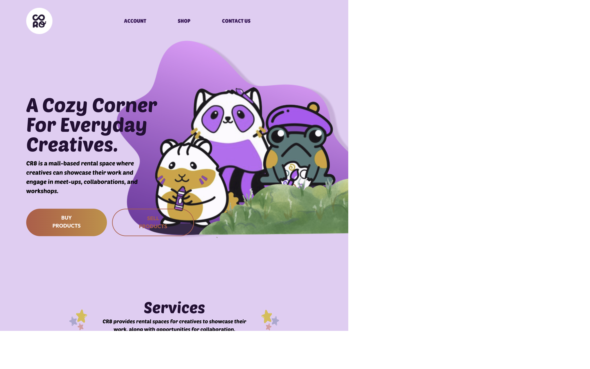
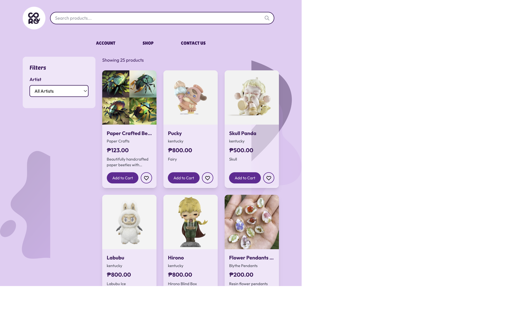

<div align="center">

# CR8

### A Cebu-focused storefront and admin system for independent brands.

<p>
  <a href="https://cr8.dcism.org"></a>
  <a href="https://github.com/kntucky-y/CR8"></a>
</p>

</div>

## Overview

CR8 is a Cebu-focused e-commerce prototype built around two web applications
and a shared PHP JSON API:

- **Customer storefront** for browsing products, brands, and shopping flows
- **Admin dashboard** for catalog, orders, and business operations
- **Shared API layer** for customer and administrator data

The project is deployed on the school server and includes the frontend assets,
product imagery, and PHP dependencies needed by the running system.

## Website preview

These captures are from the live CR8 website:
<https://cr8.dcism.org>.

<p align="center">
  
  
</p>

CR8's product catalog is backed by brand and product imagery in
[`cr8/cr8images`](cr8/cr8images), with additional storefront assets in each
frontend's `public/` and `src/assets/` directories.

## Architecture

```text
Customer storefront (React + Vite + Tailwind)
                    │
                    ├── PHP JSON API
                    │
Admin dashboard (React + Vite + Tailwind + Chart.js)
                    │
                    ▼
             School-server deployment
```

## Features

- Product and brand browsing
- Customer-facing storefront flows
- Admin catalog and operations dashboard
- Chart-based admin reporting
- Shared JSON endpoints for both applications
- Standard REST methods: `GET`, `POST`, `PUT`, `DELETE`, and `OPTIONS`
- Product image and uploaded-asset handling
- Responsive frontend structure built with Vite

## Tech stack

- **Storefront:** React 19, Vite, TypeScript, Tailwind CSS
- **Admin:** React 19, Vite, TypeScript, Tailwind CSS, Chart.js,
  `react-chartjs-2`
- **Backend:** PHP JSON API
- **Assets:** Product and brand images, uploads, and shared static resources
- **Deployment:** School server

## Repository layout

```text
cr8/        Customer storefront and customer API
cr8admin/   Admin dashboard and admin API
cr8images/  Product and brand images
uploads/    Runtime-uploaded assets
vendor/     PHP vendor dependencies
```

## Getting started

### Storefront

```bash
cd cr8
npm install
npm run dev
```

### Admin dashboard

```bash
cd cr8admin
npm install
npm run dev
```

PHP endpoints live under `cr8/api/` and `cr8admin/api/`. Configuration details
are intentionally kept out of this README; use the project's deployment
configuration for environment-specific values.

## License

All rights reserved. This project is not licensed for copying, redistribution,
or derivative use.
