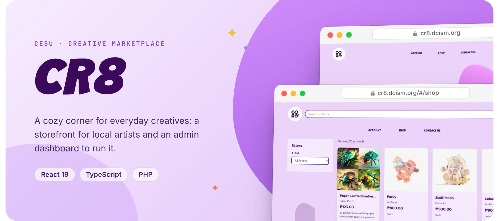
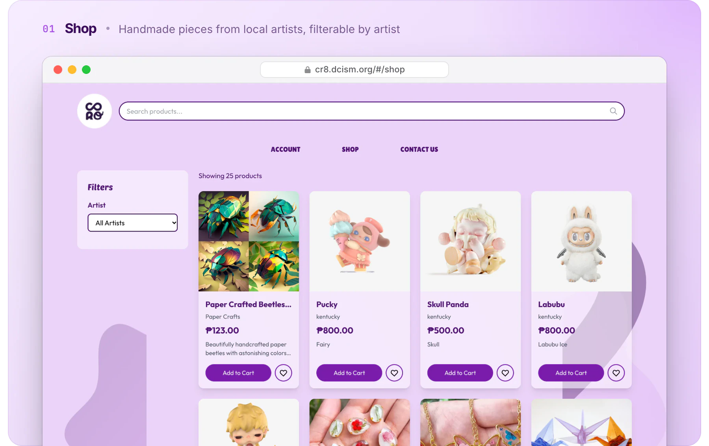
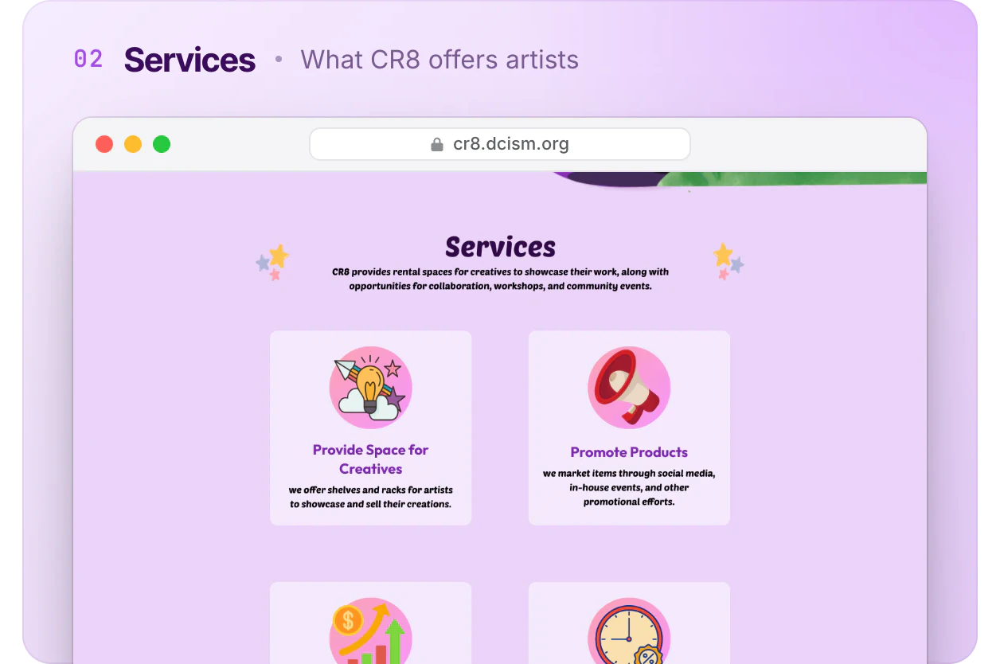
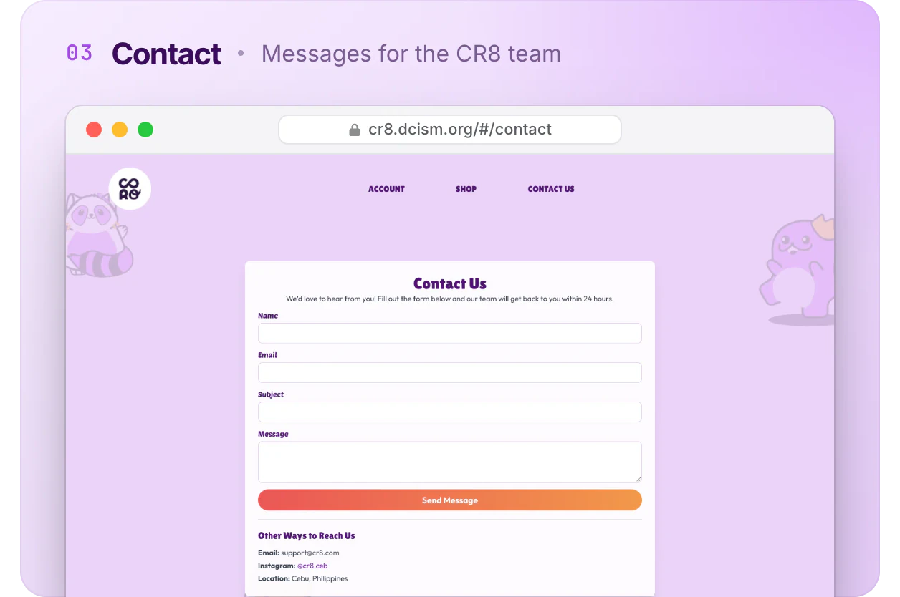

<div align="center">



<br />

<a href="https://cr8.dcism.org/"></a>


</div>

<br />

**CR8** is an e-commerce prototype for a mall-based rental space in Cebu where local creatives
showcase and sell their work. It has two React apps that share a PHP JSON API: a **storefront**
for shoppers and artists, and an **admin dashboard** for the people who run the space.

Both apps are deployed and running on the DCISM school server.

## Screenshots



<p align="center">
  <!--
  -->
</p>

## Features

| Storefront (`cr8/`) | Admin dashboard (`cr8admin/`) |
| --- | --- |
| Shop with search and filter by artist | Sales dashboard with Chart.js |
| Cart, wishlist and checkout | Orders, customers and inventory |
| Accounts with password reset by email | Artists and artist applications |
| Apply to become an artist | Inbox for contact messages, with bulk archive |
| Artists manage products and see sales reports | Reports and admin management |
| Order history | |

## Tech stack

| Layer | Tools |
| --- | --- |
| Frontend | React 19, TypeScript, Vite, Tailwind CSS, React Router |
| Charts | Chart.js with react-chartjs-2 (admin) |
| Backend | PHP JSON endpoints, PHPMailer, MySQL |
| Hosting | DCISM school server |

## Getting started

Each app is a standalone Vite project.

```bash
# storefront
cd cr8 && npm install && npm run dev

# admin dashboard
cd cr8admin && npm install && npm run dev
```

The PHP endpoints live in `cr8/api/` and `cr8admin/api/` and need a PHP server with access to
the database. Connection settings are kept out of this README on purpose.

## Project structure

```text
cr8/              storefront app
  api/            PHP endpoints: products, cart, wishlist, orders, auth, reviews, contact
  src/pages/      Shop, Checkout, UserDashboard, ManageProducts, SalesReports, ...
  cr8images/      product images grouped by artist
cr8admin/         admin dashboard app
  api/            PHP endpoints: dashboard, artists, applications, customers, admin management
  src/pages/      Dashboard, Orders, Inventory, Artists, Inbox, Reports, ...
```

## License

All rights reserved. This project is not licensed for copying, redistribution, or derivative use.

<br />

<p align="center"><sub>Built in Cebu by <a href="https://github.com/kntucky-y">Kent Jester Gatchalian</a></sub></p>
